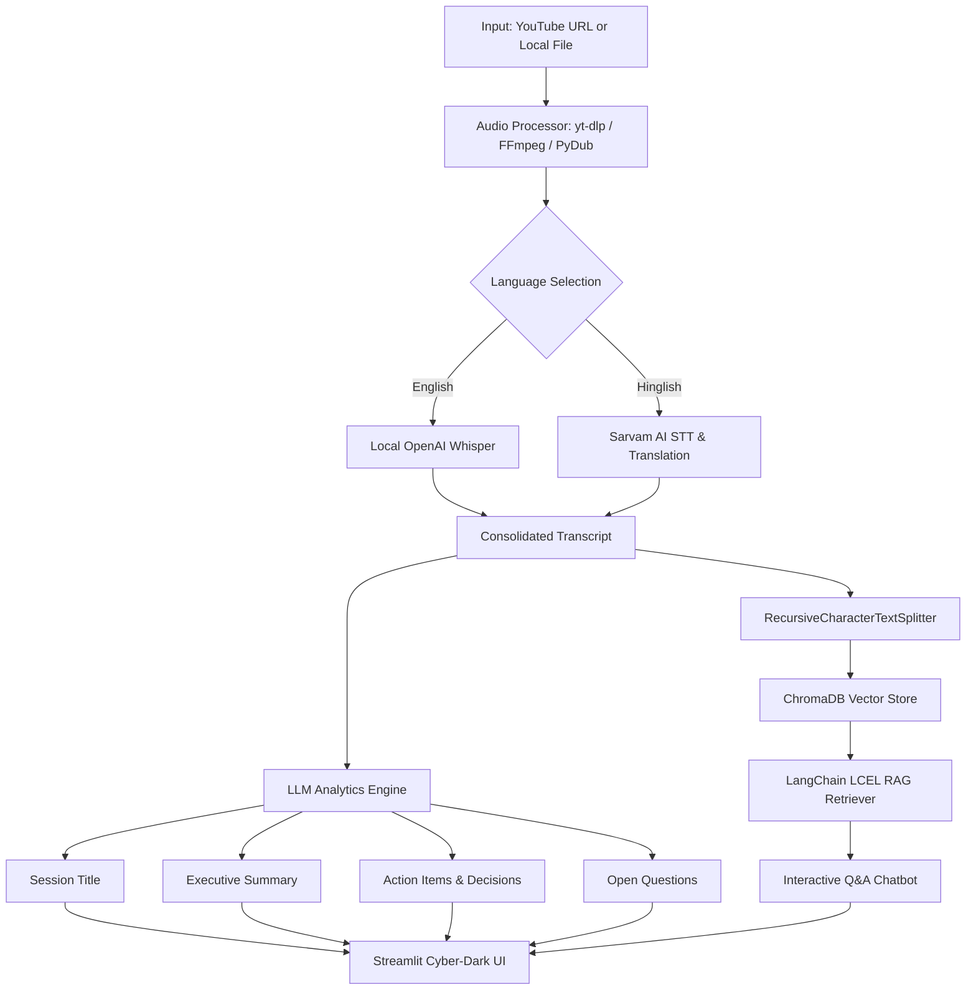

# 🎬 AI Video & Meeting Assistant

[](https://www.python.org/)
[](https://streamlit.io/)
[](https://python.langchain.com/)
[](https://github.com/openai/whisper)
[](https://www.sarvam.ai/)
[](https://www.trychroma.com/)
[](LICENSE)

An intelligent, full-stack video and meeting intelligence platform. **AI Video Assistant** ingests YouTube links or local video/audio files, transcribes speech across languages (local **OpenAI Whisper** for English and **Sarvam AI** for Hinglish translation), generates executive summaries, extracts key decisions and action items, and lets users converse with the entire meeting context via a **Retrieval-Augmented Generation (RAG)** pipeline.

---

## 🚀 Key Features

* **Dual-Source Ingestion**: Process YouTube videos via `yt-dlp` or upload local media files (`.mp4`, `.mkv`, `.mp3`, `.wav`, etc.).
* **Hybrid Speech-to-Text Architecture**:
  * **English**: High-accuracy local [OpenAI Whisper](https://github.com/openai/whisper) with automatic GPU (CUDA FP16) and CPU (FP32) optimization.
  * **Hinglish**: [Sarvam AI](https://www.sarvam.ai/) Speech-to-Text with automatic translation into structured English.
* **Smart Audio Slicing & Chunking**: Integrated `pydub` and `ffmpeg` engine that slices long audio into optimized pieces to respect API and hardware constraints.
* **Generative Meeting Intelligence**:
  * 🏷️ **Smart Session Title**: Contextual and concise title generation.
  * 📋 **Executive Summary**: Core topic breakdown and meeting highlights.
  * ✅ **Action Items**: Concrete to-do items with task owners.
  * 🔑 **Key Decisions**: Strategic agreements and decisions made.
  * ❓ **Open Questions**: Unresolved topics and follow-up items.
* **Conversational RAG Engine**:
  * Persistent [ChromaDB](https://www.trychroma.com/) vector database with HuggingFace embeddings (`all-MiniLM-L6-v2`).
  * LangChain Expression Language (LCEL) question-answering chain.
  * Multi-provider LLM support: **Groq** (ultra-fast Qwen / LLaMA), **Hugging Face Hub** (Mistral-7B), and **Mistral AI**.
* **Modern Cyber-Dark UI**: Designed with a futuristic Streamlit theme featuring real-time stage progress indicators, expandable transcripts, responsive grids, and an interactive chat box.
* **Test Suite**: Includes backend integration tests and Playwright end-to-end (E2E) browser tests.

---

## 🏗️ Architecture & Pipeline



---

## 📁 Repository Structure

```text
AI-Video-Assistant-/
├── core/
│   ├── extractor.py          # Action items, decisions, and questions extraction
│   ├── llm_factory.py        # Dynamic provider detection (Groq / HF / Mistral)
│   ├── rag_engine.py         # LangChain LCEL RAG pipeline & Q&A logic
│   ├── summarizer.py         # Summary and title generation prompts
│   ├── transcriber.py        # Dual-engine transcription (Whisper + Sarvam AI)
│   └── vector_store.py       # ChromaDB vector store creation & retriever
├── utils/
│   └── audio_processor.py    # yt-dlp downloader, FFmpeg detector, & audio chunking
├── tests/
│   ├── test_backend.py       # Unit and integration tests for core modules
│   └── test_e2e_playwright.py# Automated Playwright browser tests
├── app.py                    # Streamlit web application & cyber-dark interface
├── main.py                   # Standalone CLI pipeline runner
├── run_tests.py              # Test runner script (--backend, --e2e, all)
├── Requirements.txt          # Python dependencies
├── pytest.ini                # Pytest configuration
└── .env.example              # Sample environment configuration template
```

---

## ⚙️ Prerequisites

1. **Python 3.10+**: Recommended version is Python 3.10 or 3.11.
2. **FFmpeg**: Required by `pydub` and `yt-dlp` for audio extraction:
   * **Windows**: `winget install Gyan.FFmpeg` or download from [gyan.dev](https://www.gyan.dev/ffmpeg/builds/)
   * **macOS**: `brew install ffmpeg`
   * **Linux**: `sudo apt install ffmpeg`
3. **Node.js** *(Optional but recommended)*: Helps `yt-dlp` resolve YouTube signature extraction tokens.

---

## 🛠️ Installation & Setup

### 1. Clone the Repository
```bash
git clone https://github.com/your-username/AI-Video-Assistant-.git
cd AI-Video-Assistant-
```

### 2. Create and Activate Virtual Environment

* **Windows (PowerShell)**:
  ```powershell
  python -m venv .venv
  .\.venv\Scripts\Activate.ps1
  ```
* **Windows (Command Prompt)**:
  ```cmd
  python -m venv .venv
  .venv\Scripts\activate.bat
  ```
* **macOS / Linux**:
  ```bash
  python3 -m venv .venv
  source .venv/bin/activate
  ```

### 3. Install Dependencies
```bash
pip install --upgrade pip
pip install -r Requirements.txt
```

---

## 🔑 Environment Variables Configuration

Create a `.env` file in the root directory:

```bash
cp .env.example .env
```

Populate the required credentials according to your preferred LLM and transcription services:

```ini
# ── LLM Inference (At least one is required) ──────────────────────────────────
# 1. Groq (Recommended: Ultra-fast & free tier)
GROQ_API_KEY=gsk_your_groq_api_key_here

# 2. Hugging Face Hub (Alternative free tier)
HUGGINGFACEHUB_API_TOKEN=hf_your_huggingface_token_here

# 3. Mistral AI (Optional fallback)
MISTRAL_API_KEY=your_mistral_api_key_here

# ── Speech-to-Text Settings ───────────────────────────────────────────────────
# Sarvam AI API Key (Required for Hinglish transcription/translation)
SARVAM_API_KEY=your_sarvam_api_key_here
SARVAM_STT_MODEL=saaras:v2.5

# OpenAI Whisper local model size ("tiny", "base", "small", "medium", "large")
WHISPER_MODEL=small
```

---

## 🖥️ Running the Application

### 1. Launch the Streamlit Web UI
```bash
streamlit run app.py
```
Open your browser at `http://localhost:8501`.

1. Enter a **YouTube URL** or paste a **local file path** in the left sidebar.
2. Select your audio language: **English** (Local Whisper) or **Hinglish** (Sarvam AI).
3. Click **Analyse Video / Audio**.
4. View real-time progress, review generated insights, and ask questions in the **Chat with your Meeting** section.

### 2. Run via CLI Pipeline
To run the automated analysis pipeline programmatically without the web interface:
```bash
python main.py
```

---

## 🧪 Running Tests

The test suite covers backend logic and end-to-end browser workflows:

```bash
# Run all tests (backend + E2E)
python run_tests.py

# Run backend unit and integration tests only
python run_tests.py --backend

# Run Playwright E2E UI browser tests only
python run_tests.py --e2e
```

---

## 🧰 Tech Stack Overview

| Category | Technology |
| :--- | :--- |
| **Web Interface** | [Streamlit](https://streamlit.io/) with custom cyber-neon CSS |
| **Orchestration** | [LangChain LCEL](https://python.langchain.com/) |
| **Vector DB** | [ChromaDB](https://www.trychroma.com/) |
| **Embeddings** | `sentence-transformers/all-MiniLM-L6-v2` |
| **Local STT** | [OpenAI Whisper](https://github.com/openai/whisper) (PyTorch CPU/CUDA) |
| **Cloud STT** | [Sarvam AI](https://www.sarvam.ai/) (Speech-to-Text Translate API) |
| **LLMs Supported** | [Groq](https://groq.com/) (Qwen/LLaMA), [Hugging Face Hub](https://huggingface.co/), [Mistral AI](https://mistral.ai/) |
| **Media Processing** | [yt-dlp](https://github.com/yt-dlp/yt-dlp), [pydub](https://github.com/jiaaro/pydub), [FFmpeg](https://ffmpeg.org/) |
| **Testing** | [pytest](https://pytest.org/), [Playwright](https://playwright.dev/) |

---

## 📄 License

This project is licensed under the [MIT License](LICENSE).
